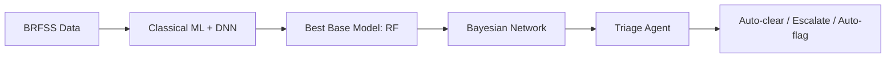
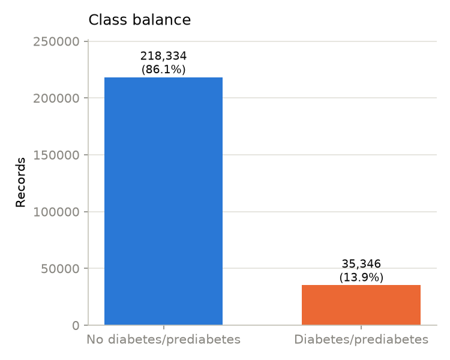
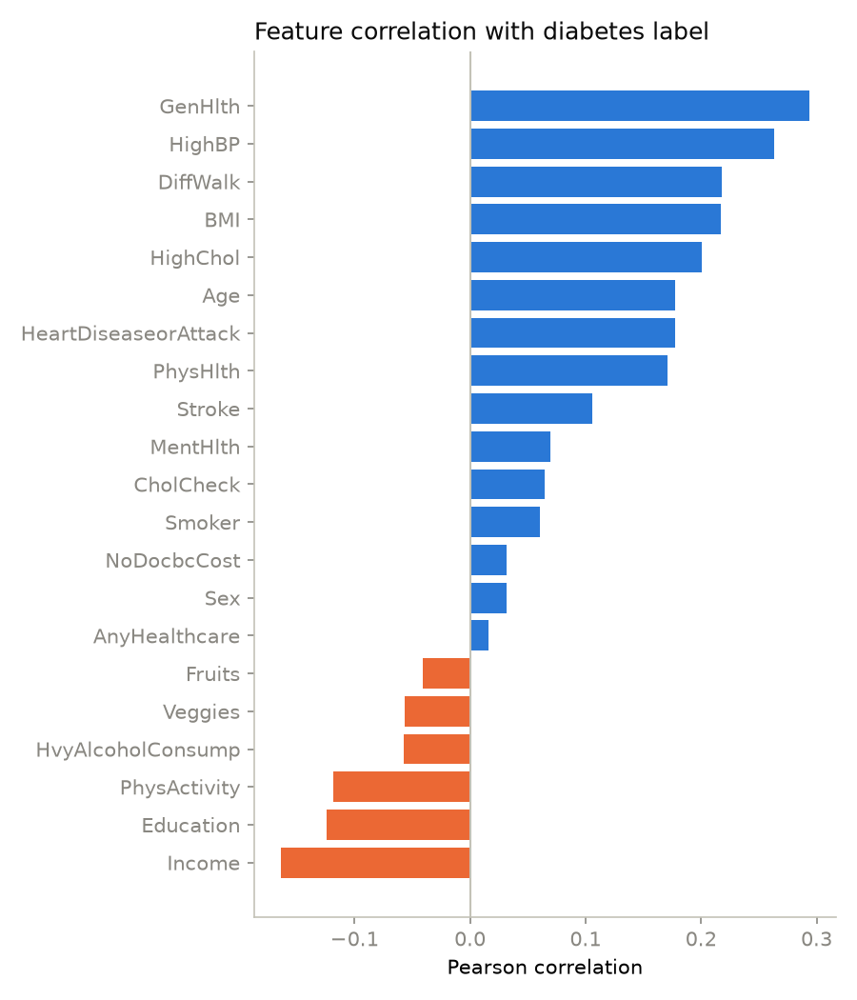
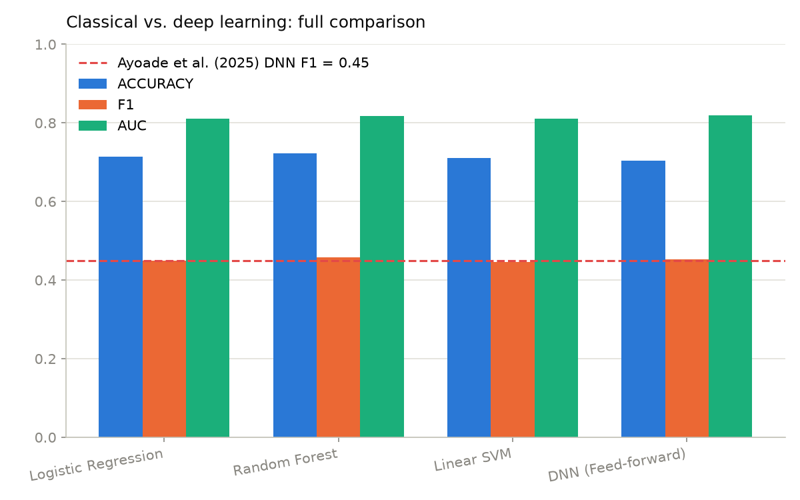
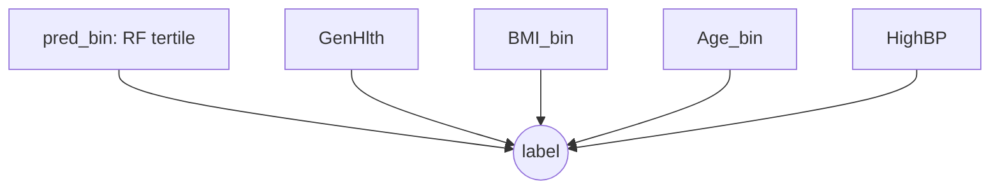
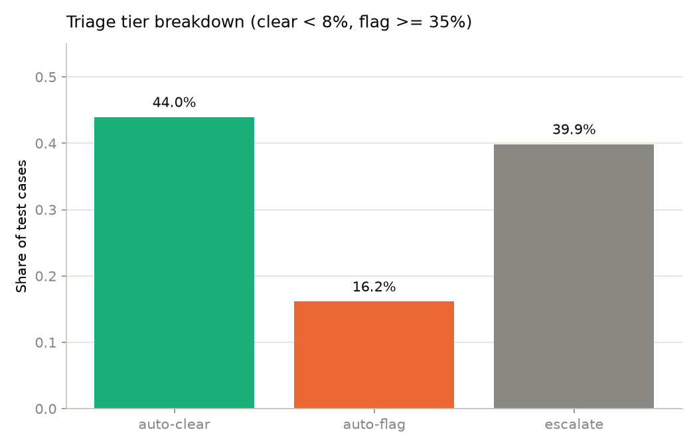
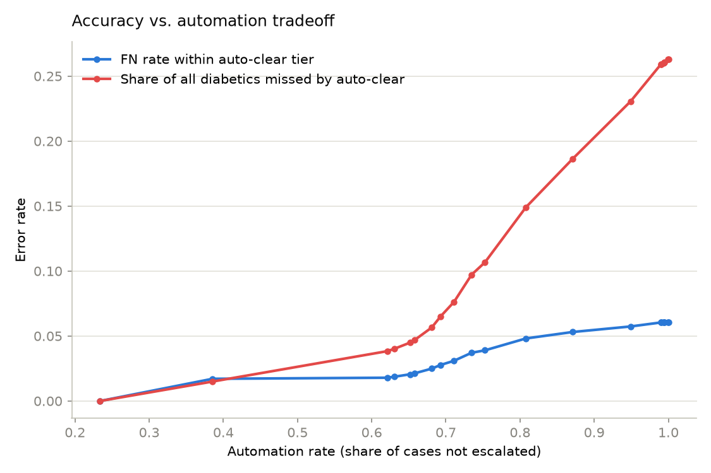

# CS 582 — Machine Learning: Group Project Report

**Project Title:** Diabetes Risk Prediction: Deep Learning vs. Classical ML with a Bayesian Uncertainty-Aware Triage Agent

**Group:** Group 10

| Group Members |
|---|
| Jephthah Kimanthi David |
| Gideon Bamuleseyo |

## Abstract

Diabetes screening at population scale needs to catch at-risk people without overwhelming
clinicians with false alarms. Rather than optimizing a single "best" classifier model, this project
layers **uncertainty estimation** on top of a strong baseline model and uses that uncertainty to
decide **which cases a machine can resolve on its own, and which need a human**. 
- (1) We train and
compare classical ML and a deep neural network on CDC BRFSS diabetes survey data, replicating a
published benchmark; 
- (2) layer a discrete Bayesian Network on the best model's output for a
calibrated per-case posterior and uncertainty score; 
- (3) build a triage agent that routes cases to
auto-clear, auto-flag, or escalate; (4) quantify the resulting accuracy-automation tradeoff.

## 1. Motivation

Most work on this dataset frames the problem as a single-model accuracy contest, ignoring the real
operational question in screening: a model is only useful if you know *when to trust it*. Ayoade et
al. (2025) showed deep learning does not reliably beat classical ML on this kind of tabular data,
redirecting the question from "which model" to "what do we do with its uncertainty." This project
adapts an uncertainty-quantification pattern from Bayesian deep learning for diabetic retinopathy
detection (Akram et al., 2025) to tabular data.

## 2. Dataset

**Source:** CDC 2015 BRFSS survey, cleaned by Alex Teboul ("Diabetes Health Indicators Dataset,"
Kaggle). **Size:** 253,680 records, 21 features, binary label. Features: 14 binary (HighBP, Smoker,
PhysActivity, …), 4 ordinal (GenHlth, Age, Education, Income), 3 numeric (BMI, MentHlth, PhysHlth).

**Cleaning:** no missing values; 24,206 exact-duplicate rows (~9.5%) removed. 
**Balance:**
84.7% negative / 15.3% positive after dedup — real clinical imbalance, not an artifact. 
**Split:**
80/20 stratified (train 183,579 / test 45,895), `StandardScaler` fit on train only.

Strongest correlates with the label — GenHlth, HighBP, DiffWalk, BMI, HighChol (positive); Income,
Education, PhysActivity (negative) — motivate the Bayesian network's evidence nodes (Sec. 4).

## 3. Baseline Models

**Classical ML** : Logistic Regression, Random Forest, Linear SVM
all with
`class_weight="balanced"`.
Notable finding: an unconstrained Random Forest produced a 1.24 GB
overfit model; constraining it (`max_depth=15, min_samples_leaf=10`) shrank it to 90 MB while
*improving* F1 (0.418→0.458) and AUC (0.785→0.817) — evidence of overfitting.

**Deep Learning**: feed-forward PyTorch network (21→64→32→1, ReLU, Dropout
0.2), `BCEWithLogitsLoss` with `pos_weight` (neural analogue of `class_weight="balanced"`), Adam
(lr 1e-3), 30 epochs, batch size 512.

| Model | Accuracy | F1 | AUC | Train time |
|---|---|---|---|---|
| Logistic Regression | 0.714 | 0.449 | 0.811 | 0.1s |
| Random Forest | 0.723 | 0.458 | 0.817 | 3.9s |
| Linear SVM | 0.710 | 0.447 | 0.810 | 0.2s |
| **DNN (feed-forward)** | 0.704 | 0.452 | **0.819** | 53.4s |

Ayoade et al. (2025) reported DNN F1 = 0.45 on this exact benchmark; ours is 0.452. The DNN edges Random Forest on AUC but has the lowest accuracy and costs 15–500x more
to train, confirming deep learning's lack of reliable advantage on tabular survey data. 
**Random
Forest is selected as the base model**: near-identical AUC, better F1/accuracy, effectively free.

## 4. Bayesian Uncertainty Layer

Random Forest's probabilities are known to be poorly calibrated. Instead of trusting that number
directly, a small discrete **Bayesian Network** treats RF's prediction as one piece of evidence
among clinically informative variables, producing a posterior plus a per-case uncertainty score.

**Fitting/inference:** `BayesianEstimator` with a Bayesian Dirichlet equivalent uniform (BDeu) prior (ESS=10) smooths conditional probability distribution (CPD) counts so no
parent-value combination gets probability exactly zero. `VariableElimination` performs exact
inference, feasible since the network is small (5 low-cardinality parents). Test rows are grouped by
unique evidence combination before inference, avoiding redundant queries at no accuracy cost.

**Uncertainty score:** binary Shannon entropy of the posterior,
`H(p) = -p·log2(p) - (1-p)·log2(1-p)`, ranging 0 (certain) to 1 bit (p=0.5, maximally uncertain).
This is *predictive* entropy over a point-estimated posterior — closer to aleatoric/ambiguity
uncertainty than full epistemic uncertainty over model parameters.

## 5. Triage Agent

A triage agent routes each case into one of three tiers by BN posterior, banded around the
training prevalence (15.3%):

| Tier | Rule | Share | Outcome |
|---|---|---|---|
| Auto-clear | p < 8% | 44.0% | FN rate 4.3% (vs. 15.3% base rate) |
| Escalate | 8% ≤ p < 35% | 39.9% | sent to human reviewer |
| Auto-flag | p ≥ 35% | 16.2% | 41.5% precision (2.7x base rate) |

**Headline:** 60.2% of cases bypass manual review while auto-clear's miss rate (4.3%) is under a
third of the population base rate — risk is genuinely concentrated, not arbitrarily split. Mean
entropy is 0.13 in auto-clear vs. 0.97 in auto-flag and 0.64 in escalate: the model calls *negative*
risk with much higher confidence than *positive* risk (a direct effect of the 85/15 imbalance) — a
reasonable bias for a screening tool.

## 6. Accuracy-vs-Automation Tradeoff

Sweeping the escalation band's half-width from 0 (max automation) to full prevalence coverage (0%
automation), tracking auto-clear FN rate and overall missed-positive rate:

**Finding:** a clear knee at **~60–62% automation**. Below it, auto-clear FN rate stays flat near
2%. Beyond it, overall missed-positive rate roughly triples — ~4% at the knee to ~15% at 80%
automation, 26% at 100% (no escalation). Automating the "easy" ~60% costs almost nothing in missed
diagnoses; the remaining ~40% would cost substantially more — a tradeoff a single accuracy metric
cannot show.

## 7. Reference Papers

1. **Sharma & Shah (2021)** — survey of ML techniques for diabetes detection; general framing.
2. **Ayoade, Shahrestani & Ruan (2025)** — classical ML vs. feed-forward DNN on binary BRFSS data
   (DNN F1 = 0.45). We reproduce this setup (Sec. 3) and confirm their conclusion independently.
3. **Akram, Adnan, et al. (2025)** — Bayesian uncertainty for CNN-based diabetic retinopathy
   detection. We adapt the *pattern* (uncertainty layered on a point-estimate model) to a different
   modality (tabular) and base model (Random Forest, not a CNN) — our core novelty claim.

## 8. Conclusion

- Random Forest and a feed-forward DNN perform comparably on BRFSS diabetes screening, confirming
**deep learning offers no reliable edge** on this tabular data. 
- **Treating uncertainty as a first-class output:** a lightweight Bayesian Network over RF's prediction and four
clinical variables yields **calibrated per-case confidence**, which a simple triage agent converts into
an operational policy — **automating ~60% of cases** at negligible cost in missed diagnoses while
concentrating human review on genuinely ambiguous cases.
